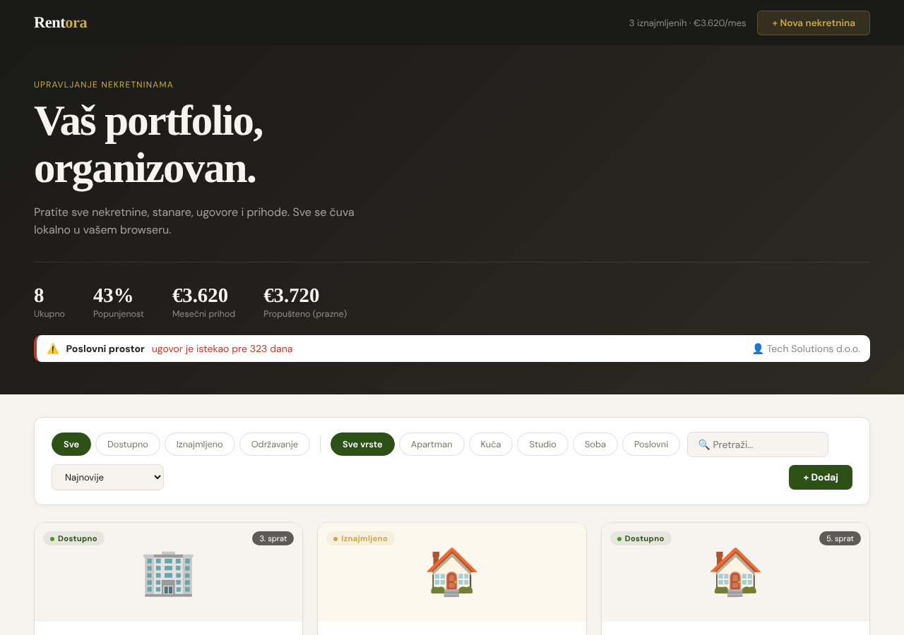

# Rentora

**Property management for small landlords** — track every unit, tenant and lease, see occupancy and monthly income at a glance, and get warned before a lease runs out.



## Features

- Portfolio of apartments, houses, studios, rooms and commercial units with status (available / rented / maintenance)
- Tenants and lease end dates; **lease alerts** for expired leases, leases ending in the next 60 days, and rented units with no end date
- Portfolio metrics: occupancy rate (excluding units under maintenance), monthly income, **vacancy loss** (income missed on empty units), average rent per m²
- Search (name, city, address, tenant), filters by status and type, sorting
- Form validation (a rented unit needs a tenant; positive rent and area); tenant data is cleared automatically when a unit is no longer rented
- Data stays in the browser (localStorage) — no account needed

## Architecture

```
src/domain.ts    types and all business rules — pure functions, unit-tested
src/main.ts      rendering and events; every user-provided value is HTML-escaped
src/seed.ts      demo portfolio
```

v2 rewrote the single-file prototype into typed modules and fixed an XSS issue: names, addresses and notes were inserted into the page as raw HTML.

## Run

```bash
npm install
npm test        # domain tests
npm run dev
```

CI runs tests and deploys `main` to GitHub Pages.

## Stack

TypeScript · Vite · Vitest · GitHub Actions / Pages

---

Built by [David Marković](https://github.com/davidmarkovic952-dev).
